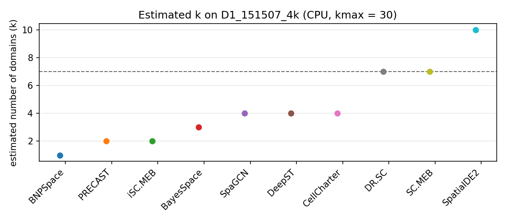
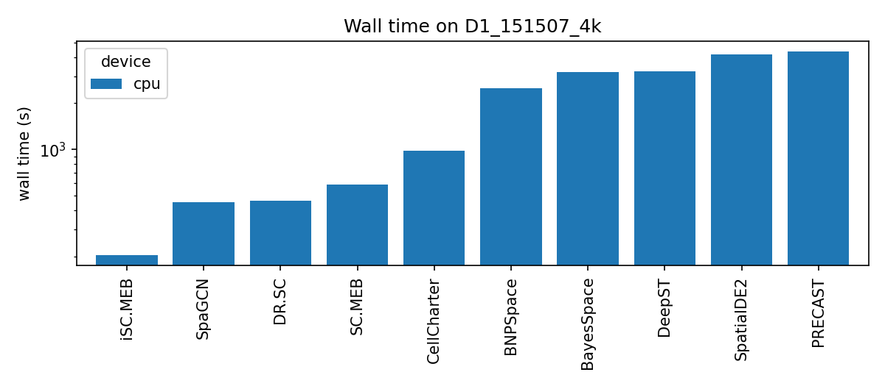
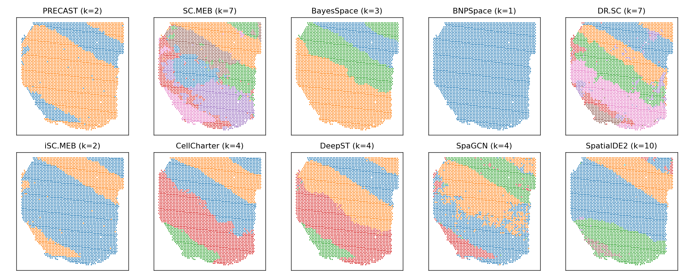
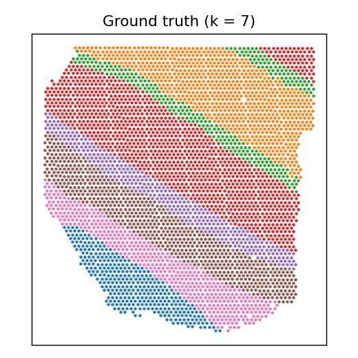

# Load and plot results

`kdb.pl` draws the figures of the benchmark from the summary table and the run folders: the
estimated k of each method, run time and memory, and maps of the spatial domains.

!!! tip "Summary"
    ```python
    import kdomainbench as kdb
    h5ad = "data/D1_151507_4k.h5ad"

    summary = kdb.load_results("out/")
    kdb.pl.plot_k_estimates(summary)                          # estimated k per method
    kdb.pl.plot_runtime(summary)                              # run time, CPU vs GPU
    kdb.pl.plot_spatial(kdb.read_clusters("out/SpaGCN"), h5ad)
    ```

All figures on this page come from the ten CPU runs on the 4k sample. Each function returns a
matplotlib axes or figure, so you can adjust and save it as usual.

## Step 1: Load a results table

```python
summary = kdb.load_results("out/")
```

One row per run, scored against the ground truth ([Evaluate a run](evaluate.md#score-many-runs)
lists the columns). Filter it like any DataFrame:

```python
summary[summary["device_used"] == "gpu"]       # GPU runs only
summary[summary["dataset"] == "D1_151507_4k"]  # one dataset
```

## Step 2: Estimated k

```python
ax = kdb.pl.plot_k_estimates(summary)
ax.figure.savefig("k_estimates.png", dpi=150, bbox_inches="tight")
```



### Reading the figure

* Each dot is one run; methods are sorted by their median estimated k.
* The dashed line is the true k (7), read from `k_true`. Pass `k_true=` to draw another.
* Dots on the line found the right number of domains. Here DR.SC and SC.MEB did; BNPSpace,
  PRECAST and iSC.MEB found far too few, and SpatialDE2 too many.

## Step 3: Run time and memory

```python
kdb.pl.plot_runtime(summary)                          # wall time (s), log scale
kdb.pl.plot_runtime(summary, metric="peak_rss_mb")    # peak host memory (MB)
```



Bars are grouped by `device_used`: with CPU and GPU runs of the same method, they stand side by
side. `log=False` switches to a linear axis.

## Step 4: Spatial domains

One method:

```python
clusters = kdb.read_clusters("out/SpaGCN")
kdb.pl.plot_spatial(clusters, h5ad, title="SpaGCN")
```

Several methods side by side; `results` maps a name to its labels, as `kdb.run_all` returns:

```python
results = {m: kdb.read_clusters(f"out/{m}/D1_151507_4k_cpu") for m in kdb.list_methods()}
fig = kdb.pl.plot_spatial_grid(results, h5ad, ncols=5)
```



The ground truth for comparison:

```python
truth = kdb.ground_truth(h5ad).rename("cluster").to_frame()
kdb.pl.plot_spatial(truth, h5ad, title="ground truth")
```

{ width="320" }

??? note "Details"
    * The maps use `obsm["spatial"]`, with the y axis flipped as in a tissue image;
      `spatial_key=` picks another `obsm` entry.
    * Colours follow the sorted label names, so the same colour in two maps does not mean the
      same domain.

Next: [the tutorials](../tutorials/index.md) run all methods and compare CPU and GPU.
