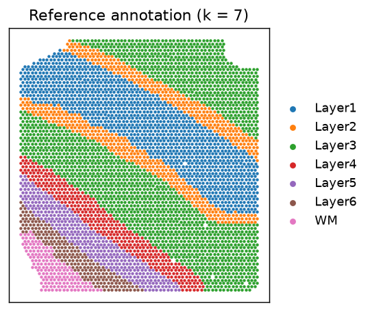
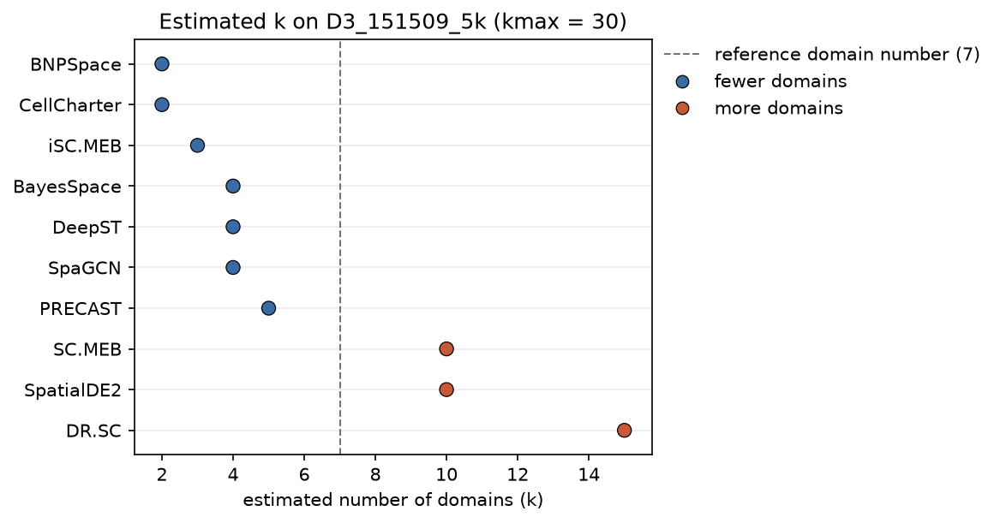
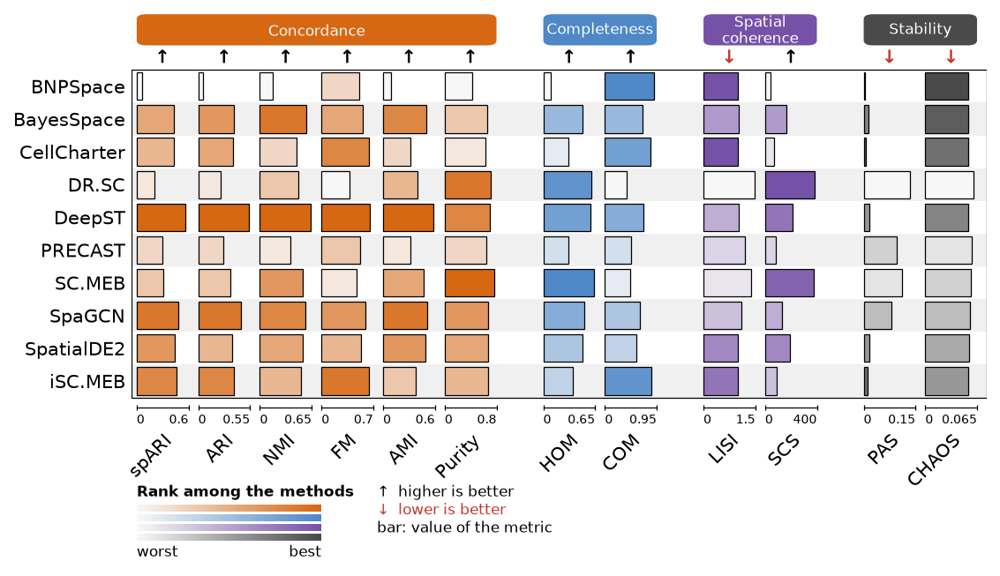

# Benchmark the ten methods

This tutorial runs all ten methods on sample 151509 and asks how close each one gets to the
reference domain number (reference k). The table and figures below show the runs of the paper's
benchmark on this sample, one per method.

!!! tip "Summary"
    ```python
    import kdomainbench as kdb
    h5ad = "data/D3_151509_5k.h5ad"

    results = kdb.run_all(h5ad, kmax=30, device="cpu", out_root="bench/")
    summary = kdb.load_results("bench/")
    kdb.k_accuracy(summary)
    kdb.pl.plot_k_estimates(summary)
    kdb.pl.plot_spatial_grid(results, h5ad)
    ```

## 1. The data

`D3_151509_5k.h5ad` is sample 151509 ([Example data](../installation.md#example-data)).
Its reference annotation has 7 domains, six cortical layers and white matter: **k = 7**.

```python
import kdomainbench as kdb

h5ad = "data/D3_151509_5k.h5ad"
reference = kdb.reference_annotation(h5ad).to_frame("cluster")
kdb.pl.plot_spatial(reference, h5ad, title="Reference annotation (k = 7)", legend=True)
```

{ width="400" }

## 2. Run every method

```python
results = kdb.run_all(h5ad, kmax=30, device="cpu", out_root="bench/")
```

`run_all` runs all ten with `kmax = 30` and otherwise as their
[method scripts](../overview.md#method-scripts) set them.

## 3. Estimated k and accuracy

```python
summary = kdb.load_results("bench/")
best_first = kdb.k_accuracy(summary).index      # smallest k error first, then highest ARI
summary.set_index("method").loc[best_first, ["k_estimated", "k_error", "ARI", "NMI"]]
```

--8<-- "results_table.md"

The methods are sorted by the size of their *k error* (estimated k − reference k), then by
ARI. ARI and NMI compare the domains with the annotated ones
([Evaluate a run](evaluate.md#what-each-score-measures)). The raw numbers are in
[`summary_5k.csv`](../assets/summary_5k.csv).

```python
kdb.pl.plot_k_estimates(summary)
```

{ width="620" }

Blue dots are below the reference k and red ones above. A dot on it would be green.

## 4. The domains on the tissue

```python
fig = kdb.pl.plot_spatial_grid(results, h5ad, ncols=5)
```


Compare each map with the reference annotation above. Colors follow the sorted label names, so
the same color in two maps does not mean the same domain.

## 5. The twelve metrics

`kdb.metrics` scores a run with the twelve metrics of the paper, and `kdb.pl.plot_metrics`
draws them:

```python
for run in summary.loc[summary["success"], "out_dir"]:
    kdb.metrics(run)                      # saved as metric.csv in the run folder
summary = kdb.load_results("bench/")      # read again, now with the metrics
kdb.pl.plot_metrics(summary)
```



A darker bar is a better rank among the ten methods
([Evaluate a run](evaluate.md#plot-the-metrics) explains the figure).

## From the shell

```bash title="terminal"
kdomainbench run -m all -i data/D3_151509_5k.h5ad -o bench/
kdomainbench metrics bench/
kdomainbench summarize bench/ --csv summary.csv --plot k.png
```

The first command runs the methods one after another, and the second needs the metric packages
([Installation](../installation.md#the-metric-packages)).
