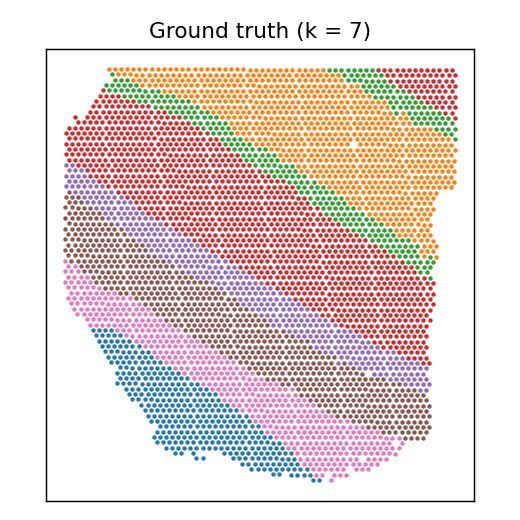
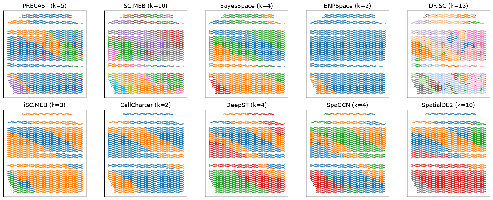
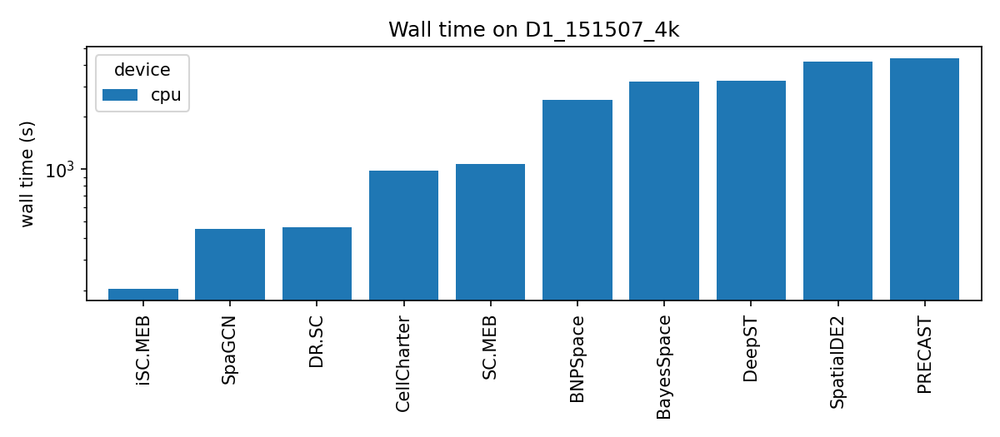

# Benchmark the ten methods

This tutorial runs all ten methods on DLPFC sample 151507 and asks how close each one gets to
the true number of domains. Every number and figure on this page comes from that run.

!!! tip "Summary"
    ```python
    import kdomainbench as kdb
    h5ad = "data/D1_151507_4k.h5ad"                    # 4 220 spots, true k = 7

    results = kdb.run_all(h5ad, kmax=30, device="cpu", out_root="bench/")
    summary = kdb.load_results("bench/")
    kdb.k_accuracy(summary)
    kdb.pl.plot_k_estimates(summary)
    kdb.pl.plot_spatial_grid(results, h5ad)
    ```

## 1. The data

`D1_151507_4k.h5ad` is DLPFC Visium sample 151507 ([Get the data](../installation.md#get-the-data)).
Its 4 220 spots carry the manual layer annotation, Layer1–Layer6 and white matter: **k = 7**.

```python
import kdomainbench as kdb

h5ad = "data/D1_151507_4k.h5ad"
truth = kdb.ground_truth(h5ad).rename("cluster").to_frame()
kdb.pl.plot_spatial(truth, h5ad, title="ground truth")
```

{ width="320" }

## 2. Run every method

```python
results = kdb.run_all(h5ad, kmax=30, device="cpu", out_root="bench/")
```

All ten ran with `kmax = 30` and the benchmark's settings
([How kDomainBench works](../methods.md#the-ten-methods)). Together they took about 6 hours on
a CPU; [Run a method](run.md) shows how to run them one at a time or on a GPU.

## 3. Estimated k and accuracy

```python
summary = kdb.load_results("bench/")
```

--8<-- "results_table.md"

*k error* = estimated k − true k. ARI and NMI compare the domains with the annotated layers
([Evaluate a run](evaluate.md#what-each-score-measures)). *Wall time* covers the whole
run, data loading included; *peak RAM* is host memory only. The raw numbers are in
[`summary_4k.csv`](../assets/summary_4k.csv).


* **DR.SC** found exactly 7 domains, and **SC.MEB** 9.
* **CellCharter, DeepST and SpaGCN** found 4, fewer than the 7 layers. DeepST still has the
  highest ARI (0.55): its 4 domains follow the layer boundaries well.
* **SpatialDE2** split the tissue into 10 domains, but only 4 of them are large: the other 6 have
  38 spots or fewer.
* **PRECAST, iSC.MEB and BayesSpace** found 2–3 domains, and **BNPSpace** put every spot in one
  cluster (k = 1, ARI 0).

## 4. The domains on the tissue

```python
fig = kdb.pl.plot_spatial_grid(results, h5ad, ncols=5)
```



Compare each map with the ground truth above: a method with too few domains merges layers into
broad bands, one with too many splits layers into patches. Colors follow the sorted label
names, so the same color in two maps does not mean the same domain.

## 5. Cost

```python
kdb.pl.plot_runtime(summary)
```



iSC.MEB, SpaGCN and DR.SC finished in under 10 minutes, and CellCharter and SC.MEB in 15–18.
BNPSpace, BayesSpace, DeepST, SpatialDE2 and PRECAST took 40–75 minutes each. BayesSpace needed
the most memory (12.0 GB).

!!! note "One dataset, one run"
    These numbers come from **one** dataset with one seed per method, on a shared 32-core
    workstation where other jobs were running, so the times are rough. They show that the
    pipeline works end to end; use more datasets and repeated runs before ranking the methods.

## Reproduce

```bash title="terminal"
kdomainbench run -m all -i data/D1_151507_4k.h5ad -k 30 -d cpu -o bench/
kdomainbench summarize bench/ --csv summary.csv --plot k.png
python scripts/make_results_page.py bench/ data/D1_151507_4k.h5ad    # this page's table and figures
```
