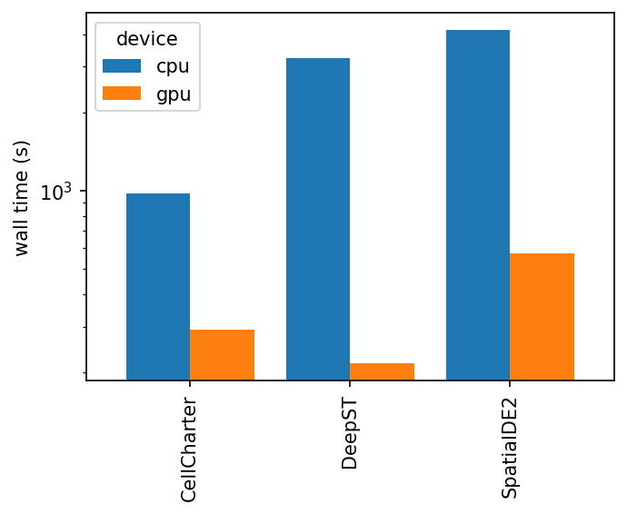

# CPU versus GPU

CellCharter, DeepST and SpatialDE2 can run on a GPU. This tutorial runs each of them on the CPU
and on GPU 0, then compares the run time and the domains.

!!! tip "Summary"
    ```python
    import kdomainbench as kdb
    h5ad = "data/D1_151507_4k.h5ad"
    for m in kdb.list_methods(gpu_only=True):
        kdb.run(m, h5ad, kmax=30, device="cpu", out_dir=f"devices/{m}/cpu")
        kdb.run(m, h5ad, kmax=30, device="gpu", gpu_id=0, out_dir=f"devices/{m}/gpu")
    kdb.pl.plot_runtime(kdb.load_results("devices/"))
    ```

## 1. Check the GPU

```bash title="terminal"
nvidia-smi                          # pick a free GPU; its index is gpu_id
kdomainbench check --gpu --gpu-id 0 # torch: CUDA available: True, tensorflow: GPUs: 1
```

!!! warning "Shared machines"
    Always pass `gpu_id` on a machine with several GPUs, so the run does not land on a GPU
    someone else is using.

## 2. Run each method on both devices

```python
import kdomainbench as kdb

h5ad = "data/D1_151507_4k.h5ad"
runs = {}
for m in kdb.list_methods(gpu_only=True):
    runs[m, "cpu"] = kdb.run(m, h5ad, kmax=30, device="cpu", out_dir=f"devices/{m}/cpu")
    runs[m, "gpu"] = kdb.run(m, h5ad, kmax=30, device="gpu", gpu_id=0, out_dir=f"devices/{m}/gpu")
```

## 3. Compare run time and memory

```python
summary = kdb.load_results("devices/")
summary[["method", "device_used", "k_estimated", "ARI", "wall_time_s", "peak_rss_mb"]]
#         method device_used  k_estimated   ARI  wall_time_s  peak_rss_mb
#    CellCharter         cpu            4  0.49       978.14       2068.9
#    CellCharter         gpu            4  0.58       291.24       2062.8
#         DeepST         cpu            4  0.55      3233.28       2932.7
#         DeepST         gpu            5  0.55       216.43       3350.9
#     SpatialDE2         cpu           10  0.41      4156.90       2900.3
#     SpatialDE2         gpu           10  0.41       571.77       1581.7

kdb.pl.plot_runtime(summary)                          # CPU and GPU bars side by side
```

{ width="420" }

On one RTX 3090, DeepST ran 15 times faster than on the CPU (4 minutes instead of 54),
SpatialDE2 7 times (10 minutes instead of 69) and CellCharter 3 times (5 minutes instead of 16).
`peak_rss_mb` is host memory. GPU memory is not recorded; watch it with `nvidia-smi` while the
run is going. Here no run used more than about 4.5 GB of it.

## 4. Do the domains change?

GPU kernels are not bit-identical to CPU kernels, so the trained embeddings, and sometimes the
chosen resolution or k, can differ between devices even with the same seed. Compare the two
runs of each method with ARI:

```python
from sklearn.metrics import adjusted_rand_score

for m in kdb.list_methods(gpu_only=True):
    cpu, gpu = runs[m, "cpu"], runs[m, "gpu"]
    print(m, round(adjusted_rand_score(cpu.loc[gpu.index, "cluster"], gpu["cluster"]), 2))
# CellCharter 0.79
# DeepST 0.58
# SpatialDE2 1.0
```

An ARI of 1 means the same domains on both devices.

* **SpatialDE2** gave the same domains on both devices.
* **CellCharter** found k = 4 on both, with partly different domains (ARI 0.79 between them).
* **DeepST** found k = 4 on the CPU and k = 5 on the GPU: the device changed its estimate.

So a GPU run is much faster but not a drop-in copy of a CPU run. Compare methods on the same
device.
