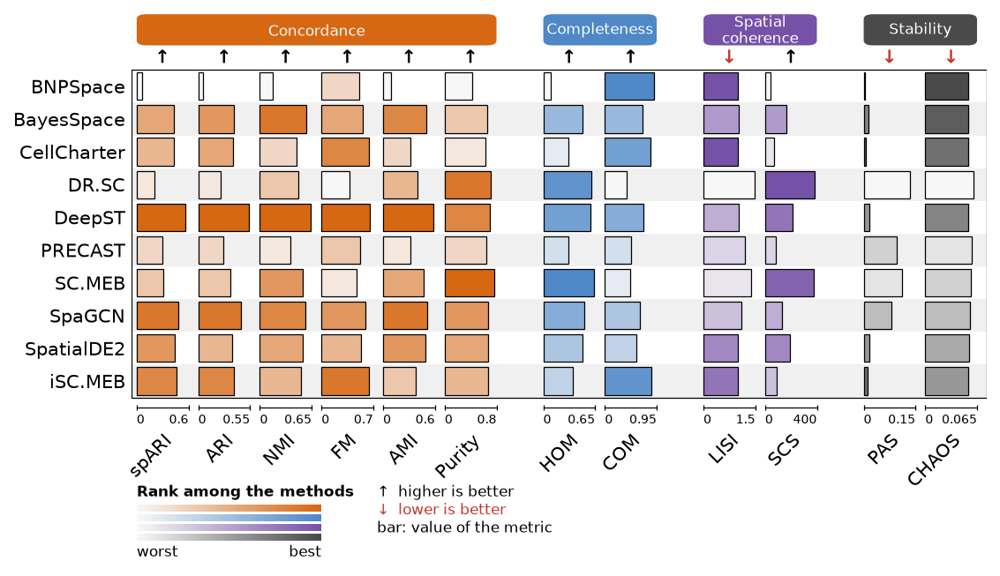

# Evaluate a run

A run gives one domain label per spot. `kdb.evaluate` compares them with the reference
annotation: how far the estimated k is from the reference k, and how well the domains agree
with the annotated ones. The examples score the runs of [Run a method](run.md), and the input
file needs a reference annotation in `obs["clusters"]`. The outputs shown are those of the
paper's benchmark runs on sample 151509.

!!! tip "Summary"
    ```python
    import kdomainbench as kdb
    h5ad = "data/D3_151509_5k.h5ad"

    clusters = kdb.read_clusters("kdb_results/SpaGCN/D3_151509_5k_cpu")  # or what kdb.run returns
    kdb.evaluate(clusters, h5ad)                  # one run: k error, ARI, NMI
    summary = kdb.load_results("kdb_results")     # every run under kdb_results/, scored
    kdb.k_accuracy(summary)                       # one row per method
    kdb.metrics("kdb_results/DR.SC/D3_151509_5k_cpu")    # the twelve metrics of the paper
    kdb.pl.plot_metrics(kdb.load_results("kdb_results")) # the metrics as a figure
    ```

## Score one run

```python
clusters = kdb.read_clusters("kdb_results/SpaGCN/D3_151509_5k_cpu")
kdb.evaluate(clusters, h5ad)
# {'k_estimated': 4, 'k_reference': 7, 'k_error': -3,
#  'ARI': 0.4487, 'NMI': 0.5694, 'n_spots_scored': 4786}
```

The second argument is the `.h5ad` file, whose `obs["clusters"]` holds the reference annotation,
or the annotation itself as a Series indexed by spot:

```python
reference = kdb.reference_annotation(h5ad)                       # obs["clusters"], spots without a label dropped
reference = kdb.reference_annotation(h5ad, reference_key="layer_guess")    # another column
kdb.evaluate(clusters, reference)
```

Another run in its place compares two methods
([Your own data](../how-to/own_data.md#the-methods-will-disagree)).

## What each score measures

| Score | Meaning | Best |
|---|---|---|
| `k_estimated` | number of distinct labels the method returned | |
| `k_reference` | number of distinct labels in the reference annotation | |
| `k_error` | `k_estimated − k_reference`. Negative means fewer domains than the annotation | 0 |
| `ARI` | adjusted Rand index between the labels and the annotation | 1 |
| `NMI` | normalized mutual information between the labels and the annotation, with the arithmetic mean of the two entropies as the norm | 1 |
| `n_spots_scored` | spots that have both a label and an annotation. ARI and NMI use these | |

Labels and annotation are matched by spot barcode. `kdb.evaluate` raises a `ValueError` when
they share no spot or when a barcode occurs twice. A partial match is scored without a warning,
so check `n_spots_scored`.

## Score many runs

`kdb.load_results` reads every `run_info.json` under a folder and scores each successful run
against its own `.h5ad` file. The result has one row per run:

```python
summary = kdb.load_results("kdb_results")
summary[["method", "k_estimated", "k_reference", "k_error", "ARI", "NMI"]]
#         method  k_estimated  k_reference  k_error     ARI     NMI
# 0     BNPSpace            2            7       -5  0.0480  0.1604
# 1   BayesSpace            4            7       -3  0.3745  0.5776
# 2  CellCharter            2            7       -5  0.3657  0.4609
# ...
```

`kdb.k_accuracy` gives one row per method, the smallest k error first, then the highest ARI:

```python
kdb.k_accuracy(summary)
#          runs  mean_abs_k_error  exact_rate  mean_ARI
# method
# PRECAST     1               2.0         0.0    0.2615
# DeepST      1               3.0         0.0    0.5416
# SpaGCN      1               3.0         0.0    0.4487
# ...
```

| Column | Meaning |
|---|---|
| `runs` | successful runs with a reference annotation |
| `mean_abs_k_error` | mean of \|k_error\| over the runs |
| `exact_rate` | fraction of runs with exactly the reference k |
| `mean_ARI` | mean ARI over the runs |

The table for all ten methods is in
[Benchmark the ten methods](benchmark.md#3-estimated-k-and-accuracy).

??? note "Failed runs, other datasets, other machines"
    * Failed runs stay in `summary` with `success = False`, and `k_accuracy` leaves them out.
    * `k_accuracy` averages over every run of a method in `summary`. With several datasets or
      devices in one folder, filter first, for example `summary[summary["dataset"] == "D3_151509_5k"]`.
    * A file without an annotation is not scored. Its runs keep `k_estimated`, and
      `score_error` says why ([Your own data](../how-to/own_data.md#3-read-the-result)).
    * Runs made on another machine record the input file's path there.
      `load_results(root, h5ad="data/D3_151509_5k.h5ad")` scores them against your copy. For
      runs of several datasets, name a file for each: `h5ad={"D3_151509_5k": "data/D3_151509_5k.h5ad", ...}`.
    * `load_results(root, reference_key="layer_guess")` scores against another `obs` column, and
      `score=False` skips scoring and only collects the run records.
    * `kdomainbench summarize --csv summary.csv` prints both tables from the command line.

## The twelve metrics of the paper

`kdb.evaluate` scores a run in Python. `kdb.metrics` computes the twelve metrics of the paper
with the paper's own code, so it needs the metric R packages
([Installation](../installation.md#the-metric-packages)) and `kdb_py`. Every spot needs a label
from the run and an annotation in `obs["clusters"]`, and the annotation needs at least two
domains.

```python
kdb.metrics("kdb_results/DR.SC/D3_151509_5k_cpu").round(4)
# metric
# ARI         0.2333
# spARI       0.2110
# NMI         0.4826
# FM          0.3780
# AMI         0.3980
# Purity      0.7048
# HOM         0.6078
# COM         0.4001
# PAS         0.1331
# CHAOS       0.0610
# LISI        1.4928
# SCS       380.8270
```

The result is saved as `metric.csv` in the run
folder. A later call reads it back, and `kdb.load_results` then adds the ten other metrics as columns. From the shell, `kdomainbench metrics kdb_results/` computes them for every finished
run that has none yet.

| Metric | What it measures | Better | Computed with |
|---|---|---|---|
| `ARI` | adjusted Rand index between the labels and the annotation | higher | clevr |
| `spARI` | an ARI that also weighs how far apart the disagreeing spots lie | higher | spARI |
| `NMI` | normalized mutual information, with the arithmetic mean of the two entropies as the norm | higher | aricode |
| `FM` | Fowlkes–Mallows index | higher | clevr |
| `AMI` | adjusted mutual information | higher | aricode |
| `Purity` | share of spots in the most common annotated domain of their label | higher | ClusterR |
| `HOM` | homogeneity: each label holds spots of one annotated domain | higher | clevr |
| `COM` | completeness: each annotated domain falls under one label | higher | clevr |
| `PAS` | share of spots with another label than most of their 10 nearest spots | lower | SpatialPCA |
| `CHAOS` | mean distance from a spot to the nearest spot with the same label | lower | SpatialPCA |
| `LISI` | median local inverse Simpson index of the labels around a spot. 1 means one label | lower | lisi |
| `SCS` | spatial coherence score: how far the label pairs of neighboring spots are from 1,000 random shuffles, as an absolute Z-score | higher | PASTE's code |

The first eight compare the labels with the reference annotation. The last four use only the
labels and the spot coordinates. [Citation](../citation.md#the-metrics) lists the publications
behind spARI and the last four.

### Plot the metrics

`kdb.pl.plot_metrics` draws the metrics of every run in a summary table, laid out as Fig. 2f of
the paper:

```python
summary = kdb.load_results("kdb_results")     # read again, now with the metrics
ax = kdb.pl.plot_metrics(summary)
ax.figure.savefig("metrics.png", dpi=150, bbox_inches="tight")
```



* **Rows and columns.** One row per method and one column per metric. The paper sorts the
  metrics into four groups: concordance with the annotation, completeness, spatial coherence
  and stability.
* **Bar.** The value of the metric, on the axis below its column. The left tick of an axis is 0,
  and a negative value is drawn to the left of it.
* **Fill.** The rank of the method among the methods for that metric. The darkest bar is the
  best one, which is the lowest value where the arrow points down (LISI, PAS and CHAOS).
* **`n/a`.** No value, such as the SCS of a run with one domain. This figure has none.

The figure shows the ten runs of
[Benchmark the ten methods](benchmark.md#3-estimated-k-and-accuracy). A method whose runs have
no `metric.csv` has only its ARI and NMI bars, and with several runs per method a bar is their
mean and a whisker their standard deviation.

??? note "Where the code comes from"
    * The code is `metrics.R` and `scs.py` in `src/kdomainbench/metric_scripts/`, unchanged
      copies of the scripts that scored the paper's benchmark. A test fails when either file
      changes.
    * The file also needs `obs["pixel_row"]`, `obs["pixel_col"]` and `obsm["spatial"]`.
      `metrics.R` reads the barcodes as numbers when they look like numbers, and then finds no
      match. Visium barcodes such as `AAACAAGTATCTCCCA-1` are not affected.
    * SCS runs in `kdb_py` because PASTE's code needs pandas below 3. With pandas 3 it returns
      no value, which `kdb.metrics` reports as an error.
    * A run with one domain has no SCS, because every shuffle of one label is the same
      labeling. The paper's results leave it empty too.
    * A failed call raises `kdb.MetricsFailed`. The output of the metric code is in
      `metric.log` in the run folder.
    * `metric.csv` is read back as it is. After the annotation changes, call
      `kdb.metrics(run, recompute=True)`.

Next: [Benchmark the ten methods](benchmark.md).
